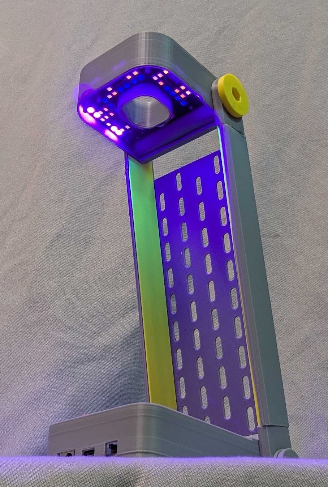

# Cyberlamp

An experiment about creating a tetrachromatic lamp, including infrared and ultraviolet light sources.

The LEDs are driven by ICs designed to control columns on hub75 matrices. Each LED can be toggled separately.

The onboard mcu CH582 can do bluetooth, so the lamps could be remotely controlled, atleast in theory.

In practice, i should've used PWM-enabled pin for `output enable` pin. Software PWM is glitchy, and becomes
unusable when handling bluetooth at the same time.

Next revision will most likely just use some dedicated LED drivers.